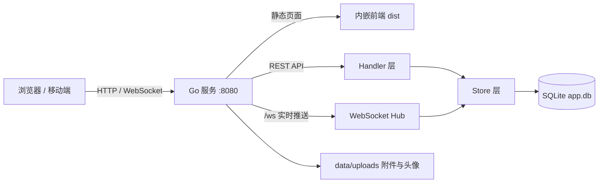

# 漂流瓶 · DriftBottle

一个轻量的匿名漂流瓶社交应用：写下心事投进海里，被陌生人捞起，开始一段匿名对话。

前后端分离开发，最终打包为**单个可执行文件**：前端资源通过 `go:embed` 内嵌进 Go 二进制，运行时只需一个进程、一个端口、一个数据目录。


## 功能特性

- **匿名注册**：无需手机号或邮箱，仅设置密码即可注册，系统随机分配 8 位数字 ID，凭 ID + 密码登录。
- **投放漂流瓶**：支持 1–500 字文字，或携带一个图片 / 音频 / 视频附件；可指定目标性别与年龄范围。
- **捞取漂流瓶**：按性别、年龄条件精确匹配，随机捞取一个未被捞走的瓶子；不喜欢可以扔回海里。
- **匿名聊天**：捞取后进入会话，支持文字与媒体消息；WebSocket 实时推送新消息、状态变化与删除事件。
- **每日配额**：每天最多投放 99 个、捞取 999 个瓶子，配额按 Asia/Shanghai 自然日重置。
- **自动清理**：消息 24 小时后过期，72 小时不活跃账户自动注销，未绑定附件 1 小时后清理。
- **个人资料**：昵称、性别、年龄、生肖预设头像或自定义头像（jpg / png / webp）。
- **防骗提醒**：每次登录后强制展示安全提示，提醒用户不要轻信陌生人、谨防诈骗。
- **移动端适配**：PC 与移动端统一为居中窄栏布局，小屏下自动收紧弹窗、按钮与聊天区域。
- **单文件部署**：前端构建产物内嵌，部署时无需 Nginx、Node.js，也不需要单独托管静态文件。

## 技术栈

| 层次 | 技术 |
| --- | --- |
| 前端 | Vue 3（`<script setup>`）、Pinia、Vue Router、Vite |
| 后端 | Go 1.25、标准库 `net/http`、`gorilla/websocket` |
| 数据库 | SQLite（`modernc.org/sqlite`，纯 Go 驱动，无需 CGO） |
| 鉴权 | JWT（HS256，7 天有效）+ argon2id 密码哈希 |
| 部署 | `go:embed` 内嵌前端，单二进制 + `manage.sh` |

## 架构



所有能力由同一个端口提供：

- `/`：前端 SPA（未命中静态文件时回退 `index.html`）
- `/api/*`：REST API
- `/ws`：WebSocket 实时推送
- `/uploads/*`：头像与附件静态文件

## 目录结构

```text
DriftBottle/
├── backend/
│   ├── main.go                 # 服务入口
│   ├── go.mod
│   ├── internal/
│   │   ├── auth/               # 密码哈希、JWT、ID 生成
│   │   ├── config/             # 命令行参数 / 环境变量配置
│   │   ├── server/             # HTTP 路由、Handlers、WebSocket、清理任务
│   │   └── store/              # SQLite 访问层（用户、瓶子、消息、附件、匹配）
│   └── web/
│       ├── embed.go            # go:embed 前端产物
│       └── dist/               # 构建时生成（已被 .gitignore 忽略）
├── frontend/
│   ├── src/
│   │   ├── api/                # HTTP / WebSocket 客户端
│   │   ├── components/         # 弹窗、附件、头像等组件
│   │   ├── stores/             # Pinia 状态（auth / bottles / toast）
│   │   ├── views/              # HomeView
│   │   └── style.css           # 全局样式与响应式布局
│   ├── vite.config.js          # 开发代理：/api /ws /uploads → :8080
│   └── package.json
├── scripts/
│   ├── build.bat               # Windows 上一键构建 Windows + Linux
│   ├── build.sh                # Linux / macOS 构建 Linux 版本
│   └── manage.sh               # Linux 服务管理脚本
├── docs/
│   ├── 设计文档.md
│   └── 开发记录.md
└── README.md
```

## 快速开始

### 环境要求

- Go **1.25+**
- Node.js **20.19+**（或 22.12+）与 npm

### 1. 构建前端并复制到内嵌目录

后端通过 `go:embed` 内嵌 `backend/web/dist`，首次运行前需要先生成它：

```bash
cd frontend
npm install
npm run build
cd ..

# macOS / Linux
rm -rf backend/web/dist && cp -r frontend/dist backend/web/dist
```

```bat
:: Windows
if exist backend\web\dist rmdir /s /q backend\web\dist
xcopy /e /i /y frontend\dist backend\web\dist
```

### 2. 启动后端

```bash
cd backend
go run . -port 8080 -data ./data
```

浏览器访问 <http://localhost:8080> 即可使用完整应用。

### 3. 前端热更新开发（可选）

另开一个终端：

```bash
cd frontend
npm run dev
```

访问 <http://localhost:5173>。Vite 已将 `/api`、`/ws`、`/uploads` 代理到 `http://localhost:8080`，修改前端代码会热更新。

> 提示：开发时后端仍需能编译（即 `backend/web/dist` 必须存在），按第 1 步生成一次即可。

## 构建与部署

### Windows：一次构建双平台

```bat
scripts\build.bat
```

输出到 `dist\<yyMMdd_HHmmss>\`：

```text
dist/261018_152813/
├── driftbottle.exe   # Windows amd64
├── driftbottle       # Linux amd64（ELF）
└── manage.sh         # Linux 管理脚本
```

### Linux / macOS：构建 Linux 版本

```bash
bash scripts/build.sh
```

输出 `dist/<时间戳>/driftbottle`（Linux amd64）与 `manage.sh`。

两个脚本都会自动完成：安装前端依赖 → 构建前端 → 复制到 `backend/web/dist` → 交叉编译后端（`CGO_ENABLED=0`，静态二进制）。

### 使用 manage.sh 管理服务（Linux）

```bash
cd dist/<时间戳>
chmod +x manage.sh driftbottle
./manage.sh start     # 启动
./manage.sh status    # 查看状态
./manage.sh log       # 实时查看日志
./manage.sh restart   # 重启
./manage.sh stop      # 停止
```

默认端口 `8080`，数据目录为版本目录上一级的 `data/`（升级版本不会丢数据），日志与 PID 保存在版本目录内。

### 手动运行

```bash
./driftbottle -port 8080 -data /var/lib/driftbottle
```

## 配置

配置优先级：**命令行参数 > 环境变量 > 默认值**。

| 命令行参数 | 环境变量 | 默认值 | 说明 |
| --- | --- | --- | --- |
| `-port` | `PORT` | `8080` | HTTP 监听端口 |
| `-data` | `DATA_DIR` | `./data` | 数据目录（数据库、密钥、上传文件） |
| `-cleanup-interval` | `CLEANUP_INTERVAL` | `10m` | 后台清理任务周期，Go duration 格式（如 `30m`、`1h`） |

`manage.sh` 额外支持 `PORT`、`DATA_DIR`、`LOG_LINES` 环境变量。

### 数据目录

```text
data/
├── app.db          # SQLite 数据库
├── app.db-wal      # WAL 日志
├── app.db-shm      # 共享内存索引
├── jwt.key         # 自动生成的 JWT 签名密钥（首次启动创建，权限 0600）
└── uploads/
    ├── <头像文件>
    └── attachments/
        └── <附件文件>
```

> `-data` 是相对**启动时工作目录**解析的。建议部署时显式指定绝对路径，避免在不同目录启动导致数据分散。

## 业务规则

- **账户**：8 位数字 ID（首位非 0），默认昵称 `用户` + ID 后四位；密码 6–32 位，至少包含一个字母与一个数字。
- **瓶子状态**：`SEA(0)` 海上待捞 → `HELD(1)` 已捞取未回复 → `CHATTING(2)` 会话中；`HELD` 状态下可扔回海里，任一方删除后瓶子即不可见。
- **匹配规则**：捞取者年龄需落在瓶子目标年龄区间内；瓶子目标性别为「不限」或与捞取者性别一致；不会捞到自己投放的瓶子。
- **配额**：每日投放上限 99、捞取上限 999；没有匹配到瓶子时不消耗捞取配额。
- **有效期**：消息 24 小时过期；最近登录超过 72 小时的账户会被清理（在线连接中的账户跳过）；上传后 1 小时仍未绑定的附件会被清理。
- **登录凭证**：JWT 有效期 7 天；退出登录时 `token_version` 自增，使已签发的旧令牌立即失效。

## API 概览

除注册、登录与健康检查外，所有接口都需要请求头：

```http
Authorization: Bearer <token>
```

| 方法 | 路径 | 说明 |
| --- | --- | --- |
| `GET` | `/api/health` | 健康检查 |
| `POST` | `/api/register` | 注册（仅密码），返回 ID 与令牌 |
| `POST` | `/api/login` | 登录（ID + 密码） |
| `POST` | `/api/logout` | 退出登录，旧令牌立即失效 |
| `GET` | `/api/me` | 当前用户信息 |
| `PUT` | `/api/me/profile` | 更新昵称、性别、年龄 |
| `POST` | `/api/me/avatar` | 上传头像（≤ 2 MiB，jpg / png / webp） |
| `PUT` | `/api/me/avatar-preset` | 选择生肖预设头像 |
| `PUT` | `/api/me/password` | 修改密码 |
| `POST` | `/api/attachments` | 上传附件（≤ 50 MiB） |
| `POST` | `/api/bottles` | 投放瓶子（文字 1–500 字，或携带一个附件） |
| `POST` | `/api/bottles/pick` | 捞取一个瓶子 |
| `POST` | `/api/bottles/{id}/return` | 将持有的瓶子扔回海里 |
| `GET` | `/api/bottles` | 我的瓶子列表 |
| `GET` | `/api/bottles/{id}` | 瓶子详情与会话消息 |
| `DELETE` | `/api/bottles/{id}` | 删除瓶子 |
| `POST` | `/api/bottles/{id}/messages` | 发送消息（文字 1–500 字，或携带一个附件） |
| `GET` | `/api/quotas` | 当日剩余投放 / 捞取配额 |
| `GET` | `/ws?token=<JWT>` | WebSocket 实时推送 |
| `GET` | `/uploads/*` | 头像与附件静态文件 |

### WebSocket 事件

连接方式：`ws://<host>/ws?token=<JWT>`。仅由服务端推送，客户端可发送 `{"type":"ping"}` 心跳，服务端回复 `pong`。

| `type` | 说明 |
| --- | --- |
| `message` | 会话收到新消息 |
| `bottle_update` | 瓶子状态变化（如被捞取、进入会话） |
| `bottle_deleted` | 瓶子被删除 |

## 安全说明

- 密码使用 **argon2id** 加盐哈希（time=2、memory=19 MiB、threads=1、keyLen=32），数据库中不保存明文。
- 登录凭证为 **HS256 JWT**，有效期 7 天；签名密钥首次启动时随机生成并持久化到 `data/jwt.key`。
- 支持服务端强制下线：令牌携带 `token_version`，退出登录或修改密码后旧令牌失效。
- 所有 SQL 均使用参数化查询，避免 SQL 注入。
- 上传文件按 MIME 白名单校验，静态响应附加 `X-Content-Type-Options: nosniff`。
- 附件单文件上限 50 MiB，头像上限 2 MiB；接受图片、音频、视频常见格式。
- 建议生产环境置于 HTTPS 反向代理之后，避免令牌与消息在明文 HTTP 中传输。

## 已知限制

- 定位为单机部署：SQLite 单连接写入，不适合多实例水平扩展。
- WebSocket 仅支持在线推送，没有离线消息通知或系统级推送。
- 不含内容审核、举报与拉黑机制，公开部署前请自行评估合规要求。
- 匿名社交存在诈骗与骚扰风险，项目内置的登录提醒不能替代平台级风控。

## 贡献

欢迎提交 Issue 与 Pull Request。

1. Fork 本仓库并创建分支：`git checkout -b feat/your-feature`
2. 提交前请确保：
   - Go 代码通过 `gofmt`，后端可编译：`cd backend && go build ./...`
   - 前端可构建：`cd frontend && npm run build`
3. 提交 PR 并说明改动内容与验证方式。

## License

本项目基于 [MIT License](LICENSE) 开源。

## 免责声明

本项目仅用于学习与技术交流。请勿用于传播违法、色情、诈骗或其他不当内容。匿名不等于无责任，请遵守当地法律法规与网络社区规范。
