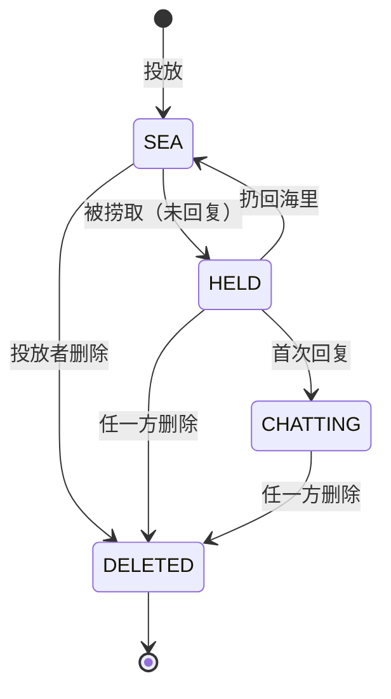

# 漂流瓶 设计文档

> 版本：v1.0（初稿）
> 依据：`README.md` 初步构想 + 需求确认问答
> 文档范围：产品设计 + 技术设计（合并）

---

## 1. 背景与目标

**背景**：用户希望通过"漂流瓶"这种轻量、半匿名的玩法，把一个瓶子投进海里，由符合条件（性别、年龄范围）的陌生人捞到并开启一对一私聊；同时系统要保持"干净"，长期不活跃的账户、过期的消息会被自动清除。

**目标**（可观察结果）：

- 新用户仅凭一个密码即可完成注册，并获得系统分配的 8 位数字 ID，凭 ID + 密码登录。
- 用户可以投放带筛选条件（目标性别、年龄范围）的瓶子，并被符合条件的陌生用户捞到、打开、开启私聊。
- 双方可以围绕一个瓶子持续收发消息；新消息到达时对应瓶子在列表中标红；打开会话即清除标红。
- 任一方删除瓶子时，瓶子与其中聊天记录对双方同时彻底删除。
- 超过 72 小时未登录的账户及其全部瓶子、消息被系统自动清除。

**不做**：好友关系、群聊、举报/拉黑、密码找回、管理员后台、消息推送之外的通知渠道。

---

## 2. 术语表

| 术语 | 定义 |
|---|---|
| 游客 | 未登录的访问者，仅可访问注册/登录。 |
| 用户 | 已登录的注册账户。 |
| 瓶子（Bottle） | 一次投放产生的一次性会话载体，包含投放内容、目标筛选条件、状态和被捞取后的聊天记录。 |
| 投放（扔瓶子） | 用户创建并投出一个瓶子到"海里"。 |
| 捞取（捞瓶子） | 从满足自身条件的"海上的瓶子"中随机获取一个。 |
| 扔回海里 | 捞取者在不回复的情况下，把瓶子放回"海里"等待他人捞取。 |
| 会话 | 瓶子被捞取者首次回复后，投放者与捞取者之间的一对一聊天。 |
| 配额 | 用户每个自然日的投放次数上限与捞取次数上限。 |
| 活跃 | 用户在 72 小时内有登录行为。 |

---

## 3. 角色与对象模型

### 3.1 角色

| 角色 | 权限范围 |
|---|---|
| 游客 | 仅可注册、登录。 |
| 用户 | 除注册/登录外的全部功能：资料设置、修改密码、投放、捞取、查看列表、会话聊天、删除瓶子、退出登录。 |

无管理员角色。

### 3.2 核心对象

- **账户（User）**：ID、密码、昵称、头像、性别、年龄、最近登录时间。
- **瓶子（Bottle）**：投放者、投放内容、目标性别、目标年龄范围、状态、捞取者、时间戳。
- **消息（Message）**：所属瓶子、发送者、内容、发送时间、过期时间。

### 3.3 瓶子状态机



| 状态 | 含义 | 是否可被捞取 | 可执行操作 |
|---|---|---|---|
| SEA（海上） | 已投放，等待捞取 | 是 | 投放者删除 |
| HELD（持有中） | 已被某用户捞取，尚未回复 | 否 | 捞取者回复 / 扔回海里；任一方删除 |
| CHATTING（会话中） | 捞取者已回复，锁定唯一对话者 | 否 | 双方收发消息；任一方删除 |
| DELETED（已删除） | 终态，彻底移除 | 否 | 无 |

**状态约束**：进入 CHATTING 后不可再扔回海里；任一方的删除都会使瓶子直接进入 DELETED。

---

## 4. 范围

### 4.1 P0（首个可交付版本必须完成）

1. 注册、登录、退出登录
2. 个人资料设置（昵称、头像、性别、年龄）
3. 修改密码
4. 投放瓶子（含目标性别、年龄范围筛选）
5. 捞取瓶子（严格匹配）
6. 打开瓶子 / 扔回海里
7. 瓶子列表（投放的 + 捞到的）
8. 会话消息收发、新消息标红、打开清除标红
9. 删除瓶子（双删）
10. WebSocket 实时新消息通知
11. 每日配额限制（投放 99 / 捞取 999）
12. 72 小时不活跃账户自动清理、消息 24 小时自动过期

### 4.2 P1（首版可暂缓）

- 头像裁剪、多尺寸缩略图
- 消息发送时间友好展示、离线消息补推
- 简易数据统计（如每日活跃）

### 4.3 明确排除

- 好友、关注、群聊、语音/图片消息
- 举报、拉黑、内容审核后台
- 密码找回（无邮箱/手机号）
- 多设备登录冲突处理之外的会话管理

---

## 5. 核心流程

### 5.1 注册

```
游客输入密码 → 校验密码强度 → 生成唯一 8 位数字 ID
→ 创建账户（性别/年龄为空，昵称取默认值）
→ 返回 ID 并弹窗提示"请务必牢记你的 ID"
→ 自动登录进入主界面
```

### 5.2 登录

```
游客输入 ID + 密码 → 校验存在性与密码哈希 → 更新最近登录时间
→ 签发登录凭证 → 进入主界面
```

### 5.3 投放

```
用户点击"扔瓶子" → 输入投放内容 + 目标性别 + 目标年龄范围
→ 校验今日投放配额（< 99）、字段合法性
→ 创建瓶子（状态 SEA）→ 计入今日投放次数
→ 瓶子出现在自己的瓶子列表
```

### 5.4 捞取

```
用户点击"捞瓶子" → 校验今日捞取配额（< 999）
→ 校验自身资料（性别、年龄已设置）
→ 从 SEA 状态且满足匹配条件的瓶子中随机取一个
→ 有结果：瓶子置为 HELD、记录捞取者、计入今日捞取次数、打开瓶子详情
→ 无结果：提示"海里暂时没有符合条件的瓶子"
```

### 5.5 打开 / 扔回

```
捞取者打开瓶子：
  回复 → 瓶子置为 CHATTING，锁定唯一对话者，对方收到消息
  扔回海里 → 瓶子置回 SEA，清空捞取者，等待他人捞取（不消耗投放次数）
```

### 5.6 会话聊天

```
任一方在瓶子详情中发送消息 → 落库（expire_at = 发送时间 + 24h）
→ 通过 WebSocket 推送给对方 → 对方对应瓶子标红
→ 对方打开该瓶子 → 清除标红
```

### 5.7 删除（双删）

```
任一方点击删除瓶子 → 二次确认 → 瓶子及其全部消息对双方彻底删除
→ 双方列表同时移除该瓶子（通过 WebSocket 通知在线方）
```

---

## 6. 功能需求

### 模块 A：账户与认证

- **目的**：让用户以最低门槛进入，并能凭 ID + 密码再次登录。
- **触发**：游客访问站点；已登录用户可退出。
- **处理规则**：
  - 注册仅需密码，系统生成唯一 8 位数字 ID（首位非 0），保证全局唯一。
  - 密码长度 6–32 位，至少包含字母与数字。密码以加盐哈希存储，明文不落库。
  - 注册成功后必须向用户展示 ID，并要求用户确认"我已记住"后再进入主界面。
  - 登录使用 ID + 密码，失败时统一提示"ID 或密码错误"，不区分具体原因。
  - 登录成功后更新"最近登录时间"。
- **结果与状态变化**：创建账户记录；签发登录凭证（JWT，有效期 7 天）；退出登录时服务端令牌版本号自增，使已签发凭证立即失效。
- **异常**：
  - 密码不合规 → 提示规则，不创建账户。
  - ID 生成冲突 → 重新生成（极低概率）。
  - 凭证过期 → 跳转登录页。
- **字段**：

| 字段 | 类型 | 必填 | 说明 |
|---|---|---|---|
| ID | 字符串（8 位数字） | 系统生成 | 全局唯一，注册后展示 |
| 密码 | 字符串 | 是 | 6–32 位，含字母与数字 |

### 模块 B：个人资料

- **目的**：让用户可被识别（昵称、头像），并可被年龄/性别匹配。
- **触发**：登录后点击"设置"。
- **处理规则**：
  - 昵称：1–20 字，默认值为 `用户` + ID 后 4 位，可修改。
  - 头像：支持上传 jpg/png/webp，单文件 ≤ 2MB；未设置时使用内置默认头像。
  - 性别：男 / 女；默认未设置。
  - 年龄：整数 1–150，直接填写；默认未设置。
  - 性别与年龄共同决定能否捞取（见共享规则 R-04）。
- **结果与状态变化**：更新账户资料，列表与瓶子上的"对方信息"同步更新。
- **异常**：头像格式/大小不符 → 拒绝并提示；年龄非整数或越界 → 拒绝并提示。
- **字段**：

| 字段 | 类型 | 必填 | 默认 | 备注 |
|---|---|---|---|---|
| 昵称 | 文本 | 否 | 用户+ID后4位 | 1–20 字 |
| 头像 | 图片文件 | 否 | 内置默认头像 | jpg/png/webp，≤2MB |
| 性别 | 枚举（男/女） | 否 | 未设置 | 未设置不可捞瓶 |
| 年龄 | 整数 | 否 | 未设置 | 1–150，未设置不可捞瓶 |

### 模块 C：投放瓶子

- **目的**：把带有筛选条件的内容投进海里。
- **界面**：主界面中部"扔瓶子"按钮 → 弹出投放窗口。
- **触发**：已登录用户点击"扔瓶子"。
- **处理规则**：
  - 内容：1–500 字，不可为空。
  - 目标性别：不限 / 男 / 女。
  - 目标年龄范围：`最小值 ≤ 最大值`，取值 1–150。
  - 每日投放上限 99 次（共享规则 R-01）。
- **结果与状态变化**：创建瓶子（状态 SEA），计入今日投放次数，加入本人瓶子列表。
- **异常**：配额用尽 → 提示"今日投放次数已用完"；字段非法 → 提示且不投出。
- **字段**：

| 字段 | 类型 | 必填 | 默认 | 校验 |
|---|---|---|---|---|
| 投放内容 | 文本 | 是 | — | 1–500 字 |
| 目标性别 | 枚举 | 是 | 不限 | 不限/男/女 |
| 目标年龄下限 | 整数 | 是 | 18 | 1–150 |
| 目标年龄上限 | 整数 | 是 | 99 | ≥下限，≤150 |

### 模块 D：捞取瓶子

- **目的**：从海里获取一个符合自身条件的瓶子。
- **界面**：主界面中部"捞瓶子"按钮 → 弹出捞取窗口。
- **触发**：已登录用户点击"捞瓶子"。
- **处理规则**：
  - 前置：今日捞取配额 < 999；自身性别与年龄均已设置。
  - 匹配条件：捞取者年龄 ∈ 瓶子目标年龄范围，且（瓶子目标性别 = 不限 或 = 捞取者性别）。
  - 从满足条件且状态为 SEA 的瓶子中随机选取一个。
  - 捞到后瓶子置为 HELD，记录捞取者，打开瓶子详情窗口。
- **结果与状态变化**：瓶子 SEA → HELD；计入今日捞取次数；进入本人瓶子列表。
- **可执行后续操作**：
  - 回复 → HELD → CHATTING（见共享规则 R-05）。
  - 扔回海里 → HELD → SEA，清空捞取者，供他人捞取。
- **异常**：
  - 资料未完善 → 提示"请先设置性别和年龄"。
  - 无匹配瓶子 → 提示"海里暂时没有符合条件的瓶子"，不消耗次数。
  - 配额用尽 → 提示"今日捞取次数已用完"。

### 模块 E：瓶子列表

- **目的**：集中展示"我投放的"和"我捞到的"瓶子及其新消息状态。
- **界面**：主界面底部横向滑动列表。
- **处理规则**：
  - 列表项展示：对方昵称与头像、最近一条未过期消息摘要、时间、未读标记。
  - 新消息到达 → 该瓶子标红；打开瓶子并加载消息 → 清除标红。
  - 已删除（DELETED）的瓶子不出现在列表中。
  - 排序：按最近消息/活动时间倒序。
- **异常**：无任何瓶子 → 展示空状态引导用户投放或捞取。

### 模块 F：瓶子详情与会话

- **目的**：查看并回复瓶子内的聊天记录，删除瓶子。
- **界面**：点击列表项 → 弹出瓶子详情窗口；顶部显示对方信息与删除入口。
- **处理规则**：
  - 展示内容：对方昵称/头像/性别/年龄、消息气泡（区分自己与对方）、发送输入框。
  - 消息：1–500 字；落库时设置 `expire_at = 发送时间 + 24h`。
  - 已过期消息不再展示（见共享规则 R-02）。
  - 发送消息后通过 WebSocket 实时推送给对方。
  - 删除瓶子为不可逆操作，需二次确认，执行双删（共享规则 R-06）。
- **状态变化**：首次回复使 HELD → CHATTING。
- **异常**：
  - 对方已删除瓶子 → 本次操作提示瓶子不存在，列表移除该项。
  - 发送失败（断网）→ 保留输入内容并提示重试。

### 模块 G：数据保留与清理

- **目的**：自动清理不活跃账户与过期消息，保持数据整洁。
- **触发**：后端定时任务（见共享规则 R-03）。
- **处理规则**：
  - 每 10 分钟扫描：删除"最近登录时间"距当前 > 72 小时且当前不在线的账户，及其全部瓶子与消息。
  - 消息过期由读取时按 `expire_at` 过滤，并可由定时任务物理删除已过期消息。
- **结果与状态变化**：账户及其瓶子进入 DELETED，数据物理移除。

---

## 7. 共享规则

### R-01 每日配额

- 每人每日投放上限 **99**、捞取上限 **999**。
- "每日"以 `Asia/Shanghai` 自然日为准，**每日 0 点重置**。
- 投放成功时投放次数 +1；捞取成功时捞取次数 +1。
- **扔回海里不新增投放次数**，也**不退还**已消耗的捞取次数。
  > 扔回仅改变瓶子状态，不影响任何已消耗配额。

### R-02 消息时效

- 每条消息以**自身发送时间 + 24 小时**为过期时刻。
- 过期后该条消息对双方均不再展示（列表摘要与详情均过滤）。
- 消息过期**不影响瓶子本身**：瓶子保留在列表中，双方仍可继续发送新消息。

### R-03 活跃与清理

- 以"最近登录时间"为活跃判据；超过 **72 小时**未登录的账户待清理。
- 清理由后端定时任务周期执行（默认每 10 分钟）。
- 清理时若该用户当前存在活跃连接（在线），本次跳过。
- 清理将物理删除账户及其全部瓶子、消息、会话记录。

### R-04 匹配规则

- 只有**性别与年龄均已设置**的用户才能捞取瓶子。
- 瓶子按目标性别与目标年龄范围筛选可捞者：
  - `捞取者年龄 ≥ 目标年龄下限` 且 `≤ 目标年龄上限`
  - 且（`目标性别 = 不限` 或 `目标性别 = 捞取者性别`）
- 从满足条件的 SEA 瓶子中随机选取一个，避免固定命中同一批瓶子。

### R-05 会话锁定

- 瓶子被捞取后进入 HELD（此期间不参与海中匹配，仅捞取者可见）。
- 捞取者**首次回复**后进入 CHATTING，锁定该用户为唯一对话者。
- 进入 CHATTING 后，其他用户不会再捞到该瓶子，捞取者也不能再"扔回海里"。

### R-06 删除（双删）

- 处于 HELD / CHATTING 的瓶子，**任一方删除即对双方彻底删除**，含全部聊天记录，不可恢复。
- 处于 SEA 的瓶子，仅投放者可删除。
- 删除操作需二次确认，并通过 WebSocket 通知在线方同步移除。

### R-07 未读与标红

- 以"每个用户对每个瓶子的最近已读时间"为准：存在来自对方且晚于该时间的消息即视为未读。
- 未读瓶子的列表项标红；打开并加载消息后清除标记。

### R-08 通知

- 通过 WebSocket 实时推送：新消息、瓶子状态变更、瓶子被删除。
- 用户离线时不做额外推送；下次登录后通过列表接口拉取未读状态。

### R-09 ID 与凭证

- ID 为系统生成的 **8 位数字**（首位非 0），全局唯一，不可修改。
- 登录凭证为 JWT，有效期 7 天；退出登录时服务端令牌版本号自增，已签发凭证立即失效。

---

## 8. 系统架构（技术设计）

### 8.1 总体形态

- **单体服务 + 单文件可执行**：后端 Go 编译为单一可执行文件，前端构建产物通过 `go:embed` 内嵌。
- 启动后**同一端口**同时提供静态页面、HTTP API 与 WebSocket。
- 用户上传的头像与 SQLite 数据库文件存放在数据目录中；默认位于各版本目录的同级 `data/` 目录（可通过 `-data` / `DATA_DIR` 配置），升级版本时数据不丢失。

```
┌─────────────────────────────────────────────┐
│                单一可执行文件                  │
│                                               │
│  HTTP/静态资源 ──┐                            │
│                  ├─▶ 路由/中间件 ─▶ 业务服务层 │
│  WebSocket ──────┘            │               │
│                               ▼               │
│                        数据访问层 (SQLite)     │
│                                               │
│  内嵌前端产物(go:embed)    data/app.db         │
│                          data/uploads/*       │
└─────────────────────────────────────────────┘
```

### 8.2 分层

| 层 | 职责 |
|---|---|
| 接入层 | 静态资源、HTTP 路由、WebSocket 升级、鉴权中间件、限流 |
| 业务服务层 | 账户、资料、投放、捞取、会话、配额、清理等业务逻辑 |
| 数据访问层 | SQLite 读写、事务、迁移 |
| 文件存储 | 头像文件读写（`data/uploads`） |

### 8.3 配置

| 配置项 | 默认 | 来源 |
|---|---|---|
| 监听端口 | 8080 | 命令行参数 / 环境变量 |
| 数据目录 | ./data | 命令行参数 / 环境变量 |
| JWT 密钥 | 首次启动生成并持久化 | 数据目录 |
| 清理任务周期 | 10 分钟 | 配置文件 |

启动时自动建库建表（迁移）并创建数据目录。

---

## 9. 数据库设计（SQLite）

启用 WAL 模式；所有时间戳以 Unix 毫秒（INTEGER）存储。

### users

| 字段 | 类型 | 约束 | 说明 |
|---|---|---|---|
| id | TEXT | PK | 8 位数字 ID |
| nickname | TEXT | NOT NULL | 昵称 |
| avatar | TEXT | | 头像相对路径，空=默认 |
| gender | INTEGER | NOT NULL DEFAULT 0 | 0未设置/1男/2女 |
| age | INTEGER | NOT NULL DEFAULT 0 | 0未设置 |
| password_hash | TEXT | NOT NULL | 加盐哈希（argon2id） |
| password_salt | TEXT | NOT NULL | 盐（argon2id 随机盐，十六进制） |
| created_at | INTEGER | NOT NULL | 创建时间 |
| last_login_at | INTEGER | NOT NULL | 最近登录时间（清理依据） |
| token_version | INTEGER | NOT NULL DEFAULT 0 | 令牌版本号；退出登录时自增，使该用户已签发的全部凭证立即失效 |

索引：`idx_users_last_login (last_login_at)`

### bottles

| 字段 | 类型 | 约束 | 说明 |
|---|---|---|---|
| id | INTEGER | PK AUTOINCREMENT | 瓶子 ID |
| owner_id | TEXT | NOT NULL, FK users(id) | 投放者 |
| holder_id | TEXT | FK users(id) | 捞取者，可空 |
| content | TEXT | NOT NULL | 投放内容 |
| target_gender | INTEGER | NOT NULL DEFAULT 0 | 0不限/1男/2女 |
| target_age_min | INTEGER | NOT NULL | 目标年龄下限 |
| target_age_max | INTEGER | NOT NULL | 目标年龄上限 |
| state | INTEGER | NOT NULL | 0 SEA/1 HELD/2 CHATTING |
| created_at | INTEGER | NOT NULL | 投放时间 |
| last_message_at | INTEGER | | 最近消息时间，用于排序 |

索引：`idx_bottles_state (state)`、`idx_bottles_owner (owner_id)`、`idx_bottles_holder (holder_id)`

匹配查询示例：

```sql
SELECT * FROM bottles
WHERE state = 0
  AND ?1 BETWEEN target_age_min AND target_age_max          -- 捞取者年龄
  AND (target_gender = 0 OR target_gender = ?2)             -- 捞取者性别
  AND owner_id <> ?3                                        -- 不捞自己的瓶子
ORDER BY RANDOM() LIMIT 1;
```

### messages

| 字段 | 类型 | 约束 | 说明 |
|---|---|---|---|
| id | INTEGER | PK AUTOINCREMENT | 消息 ID |
| bottle_id | INTEGER | NOT NULL, FK bottles(id) ON DELETE CASCADE | 所属瓶子 |
| sender_id | TEXT | NOT NULL | 发送者 |
| content | TEXT | NOT NULL | 内容 |
| created_at | INTEGER | NOT NULL | 发送时间 |
| expire_at | INTEGER | NOT NULL | 过期时间 = created_at + 24h |

索引：`idx_messages_bottle (bottle_id, created_at)`、`idx_messages_expire (expire_at)`

### attachments

| 字段 | 类型 | 约束 | 说明 |
|---|---|---|---|
| id | INTEGER | PK AUTOINCREMENT | 附件 ID |
| owner_id | TEXT | NOT NULL | 上传者（仅本人可绑定） |
| bottle_id | INTEGER | | 绑定的瓶子投放内容；NULL=未绑定到瓶子 |
| message_id | INTEGER | | 绑定的会话消息；NULL=未绑定到消息 |
| kind | TEXT | NOT NULL | 附件类型 `image`/`audio`/`video` |
| mime | TEXT | NOT NULL | 内容类型（服务端嗅探/白名单校验后写入） |
| size | INTEGER | NOT NULL | 字节数（单文件上限 50MB） |
| orig_name | TEXT | NOT NULL | 原始文件名 |
| path | TEXT | NOT NULL | 落盘相对路径（`uploads/attachments/...`） |
| created_at | INTEGER | NOT NULL | 上传时间 |

索引：`idx_attachments_bottle (bottle_id)`、`idx_attachments_message (message_id)`、`idx_attachments_owner (owner_id, created_at)`

说明：每条投放内容 / 会话消息至多 1 个附件；`bottle_id` 与 `message_id` 同时为 NULL 表示「已上传待绑定」，绑定在投放/发送的同一事务内完成（`WHERE bottle_id IS NULL AND message_id IS NULL AND owner_id = ?` 判定，防并发复用）；超期未绑定的孤儿附件由清理任务回收。附件删除与所属瓶子/消息/账户生命周期一致。

### bottle_reads

| 字段 | 类型 | 约束 | 说明 |
|---|---|---|---|
| bottle_id | INTEGER | PK(组合), FK bottles(id) ON DELETE CASCADE | 瓶子 |
| user_id | TEXT | PK(组合) | 用户 |
| last_read_at | INTEGER | NOT NULL | 最近已读时间 |

### daily_usage

| 字段 | 类型 | 约束 | 说明 |
|---|---|---|---|
| user_id | TEXT | PK(组合) | 用户 |
| usage_date | TEXT | PK(组合) | 日期 `YYYY-MM-DD`（Asia/Shanghai） |
| throw_count | INTEGER | NOT NULL DEFAULT 0 | 当日投放次数 |
| pick_count | INTEGER | NOT NULL DEFAULT 0 | 当日捞取次数 |

### 关系概览

```
users 1 ──── * bottles (owner_id)
users 1 ──── * bottles (holder_id)
bottles 1 ──── * messages
bottles 1 ──── * attachments (bottle_id)
messages 1 ──── * attachments (message_id)
bottles 1 ──── * bottle_reads
users 1 ──── * daily_usage
```

---

## 10. HTTP API 设计

统一前缀 `/api`；除注册/登录外均需鉴权（`Authorization: Bearer <token>`）。

| 方法 | 路径 | 说明 | 鉴权 |
|---|---|---|---|
| POST | `/api/register` | 注册，返回生成的 ID 与凭证 | 否 |
| POST | `/api/login` | 登录，返回凭证 | 否 |
| POST | `/api/logout` | 退出登录 | 是 |
| GET | `/api/me` | 获取当前用户资料与今日配额 | 是 |
| PUT | `/api/me/profile` | 更新昵称/性别/年龄 | 是 |
| POST | `/api/me/avatar` | 上传头像（multipart） | 是 |
| POST | `/api/attachments` | 上传媒体附件（multipart，图片/音频/视频，单文件 ≤ 50MB），返回附件 ID 供投放/发送时绑定 | 是 |
| PUT | `/api/me/password` | 修改密码（需原密码） | 是 |
| POST | `/api/bottles` | 投放瓶子 | 是 |
| POST | `/api/bottles/pick` | 捞取瓶子 | 是 |
| POST | `/api/bottles/{id}/return` | 扔回海里 | 是 |
| GET | `/api/bottles` | 瓶子列表（含未读、对方信息） | 是 |
| GET | `/api/bottles/{id}` | 瓶子详情与消息 | 是 |
| POST | `/api/bottles/{id}/messages` | 发送消息 | 是 |
| DELETE | `/api/bottles/{id}` | 删除瓶子（双删） | 是 |
| GET | `/api/quotas` | 今日剩余投放/捞取次数 | 是 |

约定：

- 统一返回结构 `{ "code": 0, "message": "ok", "data": {...} }`；`code` 为整数，`0` 表示成功，非 `0` 表示业务错误；`message` 为人类可读提示。
- 业务错误码（`code` → 名称）：

| code | 名称 | 说明 |
|---|---|---|
| 1001 | `PASSWORD_INVALID` | 密码不符合强度要求 |
| 1002 | `ID_OR_PASSWORD_WRONG` | ID 或密码错误 |
| 1003 | `UNAUTHORIZED` | 未登录或凭证已失效 |
| 1004 | `ID_GENERATION_FAILED` | ID 生成或创建账户失败 |
| 1005 | `INVALID_REQUEST` | 请求参数非法 |
| 1006 | `PROFILE_INVALID` | 资料字段非法（昵称长度、性别取值、年龄范围） |
| 1007 | `OLD_PASSWORD_WRONG` | 原密码错误 |
| 1008 | `AVATAR_INVALID` | 头像文件非法（超限或格式不支持） |
| 1009 | `QUOTA_EXCEEDED` | 当日配额已用完 |
| 1010 | `BOTTLE_INVALID` | 瓶子字段非法（内容长度、目标性别、目标年龄范围） |
| 1011 | `NO_MATCH` | 海里没有符合条件的瓶子 |
| 1012 | `PROFILE_INCOMPLETE` | 性别或年龄未设置，无法捞取 |
| 1013 | `BOTTLE_NOT_FOUND` | 瓶子不存在或当前用户无权操作 |
| 1014 | `ATTACHMENT_INVALID` | 附件非法（类型/格式不支持、超过 50MB、不存在或已被使用/不属于当前用户） |

> 后续里程碑新增错误码在此表按序追加。
- 修改密码需提交原密码与新密码；本系统**不提供密码找回**。

---

## 11. WebSocket 协议

- 端点：`GET /ws?token=<JWT>`；鉴权失败则拒绝连接。
- 传输：JSON 文本消息；服务端定时心跳（ping/pong）保活，客户端负责断线重连（指数退避）。

### 服务端 → 客户端

| type | 载荷 | 说明 |
|---|---|---|
| `message` | `{ bottleId, message }` | 有新消息到达（用于标红与实时刷新） |
| `bottle_update` | `{ bottleId, state, peer }` | 瓶子状态变更（如被捞取/进入会话） |
| `bottle_deleted` | `{ bottleId }` | 瓶子被删除（双删后通知另一方移除） |
| `pong` | `{}` | 心跳响应 |

### 客户端 → 服务端

| type | 说明 |
|---|---|
| `ping` | 心跳 |

说明：发送消息、投放、捞取等写操作统一走 HTTP API；WebSocket 仅用于服务端主动推送与保活。

---

## 12. 前端设计（Vue 3）

### 12.1 技术选型

- 框架：Vue 3 + Vite
- 状态：Pinia
- 路由：Vue Router（登录页 / 主界面）
- 网络：封装 `fetch`/`axios` 客户端，统一注入凭证与错误处理
- 实时：封装 WebSocket 客户端（连接、重连、事件分发）

### 12.2 目录结构（建议）

```
frontend/
  src/
    api/            # HTTP 接口封装
    ws/             # WebSocket 客户端
    stores/         # Pinia：user / bottles / ui
    views/          # LoginView / HomeView
    components/     # 各弹窗与列表组件
    assets/
```

### 12.3 界面与弹窗

| 界面/弹窗 | 说明 |
|---|---|
| 登录注册界面 | 单页切换登录/注册；注册成功后弹窗展示 ID 并要求确认已记住 |
| 主界面 | 顶部：头像昵称、设置、修改密码、退出；中部：扔瓶子、捞瓶子；底部：横向滑动的瓶子列表 |
| 瓶子详情弹窗 | 顶部对方信息 + 删除入口；中部消息气泡；底部输入框，可发送、删除 |
| 扔瓶子弹窗 | 内容输入 + 目标性别 + 目标年龄范围 → 扔出 |
| 捞瓶子弹窗 | 展示捞取结果（打开 / 扔回海里）；无结果时提示；资料不完整时引导设置 |
| 设置弹窗 | 修改昵称、头像、性别、年龄 |
| 修改密码弹窗 | 原密码 + 新密码 + 确认新密码 |
| 退出确认弹窗 | 二次确认退出登录 |

### 12.4 前端状态

- `user`：当前用户资料、今日剩余配额、登录凭证。
- `bottles`：瓶子列表、未读状态、当前打开的瓶子与会话。
- `ui`：当前弹窗、加载与错误提示。

---

## 13. 非功能需求

- **安全**：密码加盐哈希（bcrypt/argon2）；SQL 全部参数化；上传文件校验类型与大小并重命名存储；接口基础限流；凭证过期与失效处理。
- **性能**：SQLite 开启 WAL；为状态、外键、过期时间建索引；列表分页/懒加载。
- **可靠**：WebSocket 断线自动重连；写操作幂等保护（如重复删除返回"瓶子不存在"）。
- **可维护**：前后端分离源码、单一可执行产物、启动自动迁移。

---

## 14. 边界与异常场景

| 场景 | 处理 |
|---|---|
| 未登录访问受保护功能 | 跳转登录页 |
| 资料未完善时捞瓶 | 提示先设置性别与年龄 |
| 海里无匹配瓶子 | 提示无匹配，不消耗次数 |
| 配额用尽 | 提示"今日次数已用完"，拒绝操作 |
| 消息已过期 | 不展示，但瓶子保留，可继续聊 |
| 对方已删除瓶子 | 操作时提示瓶子不存在，列表移除 |
| 断网发送消息 | 保留输入内容并提示重试 |
| 账户 72 小时未登录 | 定时任务物理删除账户与全部数据（在线则跳过） |
| 并发双删 | 后到者返回"瓶子不存在"，不报错 |

---

## 15. 已确认的设计决策

以下为文档中依据 README 与确认问答形成、并已由需求方确认的设计决策，作为实现依据：

1. **[已确认]** 捞取后若"扔回海里"，不退还已消耗的捞取次数（仅不新增投放次数）。
2. **[已确认]** 昵称默认值为 `用户` + ID 后 4 位；头像默认使用内置默认图。
3. **[已确认]** 性别取值为"男/女"两选项，默认未设置；未设置时不可捞瓶。
4. **[已确认]** 年龄为直接填写的整数（1–150），不采用出生年份推算。
5. **[已确认]** 投放内容与单条消息长度上限均为 500 字。
6. **[已确认]** README 中"点击退出按钮，弹出修改密码窗口"应为"弹出退出确认窗口"，文档按"退出确认"实现。
7. **[已确认]** "可以打瓶子"理解为"可以打开瓶子"。
8. **[已确认]** 在线用户（存在活跃连接）在 72 小时清理时会被跳过。
9. **[已确认]** 登录凭证默认有效期 7 天；修改密码需原密码且不提供找回。
10. **[已确认]** 部署形态为单文件可执行，前端资源内嵌，上传文件与数据库存放于版本目录同级的 `data/` 目录（可通过 `-data` 配置）。
